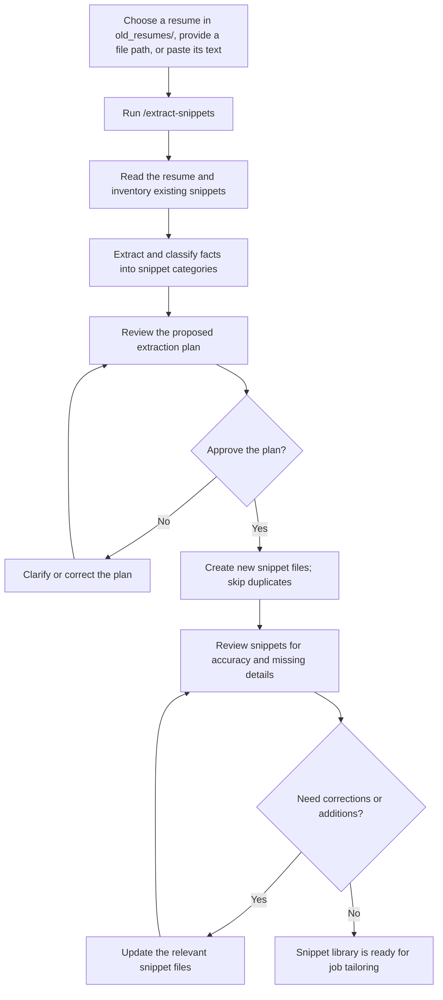
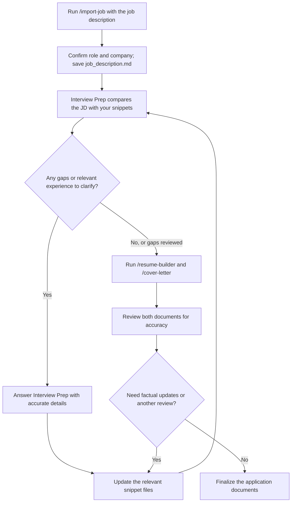

# Resume Workspace Help

This workspace stores reusable resume content as snippets, then assembles tailored application documents for individual job postings. Keep facts accurate: the tools should only use information you have provided.

Start by using your old resumes to build a library of individual snippets. Run `/extract-snippets` on a resume from `old_resumes/` (or provide its path or text); it separates roles, skills, certifications, accomplishments, education, and projects into organized files. After you review and correct them, these tagged snippets become reusable building blocks. For each new opportunity, the resume builder selects the pieces most relevant to that job instead of starting from a blank page or reusing one generic resume.

When a promising job arrives by email, paste the posting into `/import-job` and confirm the role and company. Then run `/resume-builder` on the saved job description: it matches the posting against your snippet library and creates a custom resume for that position. In just a few prompts, you can go from an emailed job posting to a tailored resume; `/cover-letter` and Interview Prep are available as follow-up steps.

## 1. Set Up the Workspace

- Fill in your name, email, phone, location, LinkedIn, and optional portfolio details in [contact.md](.github/skills/resume-builder/assets/contact.md). The resume and cover-letter workflows use this file for your contact information.
- If dependencies are not installed yet, run `npm install` from the workspace root.
- Skills from upstream projects are optional. You can browse [GitHub Awesome Copilot](https://github.com/github/awesome-copilot) and [Anthropic Skills](https://github.com/anthropics/skills). `npm run download` fetches the `docx`, `pdf`, `skill-creator`, and `doc-coauthoring` skills from Anthropic; it requires Node.js 18 or newer. Check each skill's license before downloading, retaining, or publishing it. In particular, the upstream `docx` and `pdf` licenses restrict copying and redistribution.

## 2. Build Your Snippet Library

If you have an existing resume, place a copy in `old_resumes/`, or provide Copilot its path or paste its text. Then run `/extract-snippets` and identify the source resume. It can read `.docx`, `.md`, and `.txt` files, as well as pasted text. DOCX extraction uses the `mammoth` dependency.

The extraction workflow inventories existing entries, proposes snippets for your review, and creates files only after you confirm. Content is organized into:

- `work-experience/` for roles and achievements
- `skills/` for skill categories
- `certifications/` for credentials
- `accomplishments/` for awards and notable outcomes
- `education/` for degrees and education
- `projects/` for relevant personal or side projects

Review extracted content for accuracy and duplicates. Add useful details or corrections to the snippet files themselves. Keep their `tags` specific and use metrics only when supported by your source material.

## 3. Start an Application

Run `/import-job` with the full job description, or paste the job description into chat. Confirm the company and role when prompted. The workflow creates a folder under `job_applications/` using this format:

`YYYY-MM-DD_Company-Role/`

The folder contains `job_description.md` with the job posting and its key details. Each application keeps its job description and generated documents together.

## 4. Generate the Resume

Run `/resume-builder` with the path to that application's `job_description.md` (or provide the job description directly). It compares the posting with the snippet library, prioritizes relevant experience, and saves `resume.md` in the same application folder.

Review the result before using it. Confirm names, dates, contact details, metrics, and claims; the resume must reflect your actual experience. Update the source snippet if a fact is missing or incorrect, then regenerate or request a focused revision.

## 5. Generate the Cover Letter

Run `/cover-letter` with the same `job_description.md` path (or provide the posting). It uses your contact details and relevant snippets to create a tailored letter, saved as `cover_letter.md` in that application folder. Review it for accuracy, tone, and company-specific details.

The prompts generate Markdown documents. Word-document generation is a separate workflow; see the [resume DOCX format guide](.github/skills/resume-docx-format/SKILL.md) when that capability is available.

## 6. Prepare for an Interview (Optional)

Use the **Interview Prep** agent with the job description to identify gaps between the posting and your current snippets. Add newly confirmed information to the appropriate snippet file; do not add qualifications or experience that you cannot substantiate.

## Tailoring Loop

Repeat the review and backfill cycle for each job. Only add qualifications supported by your actual experience; if a gap is not something you have done, leave it as a gap.

## Application Checklist

- Contact information is current in `contact.md`.
- The job description is saved in the correct application folder.
- Snippets contain accurate details and useful tags.
- Resume and cover letter are saved beside the job description.
- Generated documents have been reviewed for accuracy and personal information.
- Before pushing to GitHub, check for private material such as original resumes, contact information, or sensitive application documents, and check licenses for any downloaded skills.
